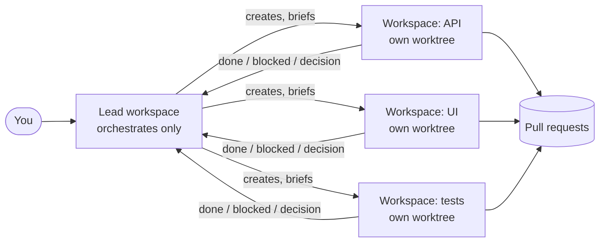

<p align="center">
  
</p>

<h1 align="center">Emjosh</h1>

<p align="center">
  Run a team of coding agents in parallel, each in its own git worktree, from one desktop app.
</p>

<p align="center">
  <a href="https://github.com/2785/emjosh/releases/latest">Download</a> ·
  <a href="#install">Install</a> ·
  <a href="CHANGELOG.md">Changelog</a>
</p>

---

Emjosh is a local-first desktop app (macOS, Linux, Windows) for working with several AI coding
agents at once. Every task gets its own branch and git worktree, so agents never trample each
other's changes, and you review each one's diff before anything is merged.

## How it works



1. **Add a project**: any local repository, or one on a remote machine over SSH.
2. **Start a workspace** for a task: pick an agent (Claude Code, Codex, Antigravity, Copilot, Cursor, OpenCode and
   dozens more), and Emjosh creates a branch and worktree and starts it.
3. **Work in parallel.** Chat with each agent, steer it mid-turn, watch its terminal, run
   scripts, and read its diff, all in the same window.
4. **Ship it.** Open the pull request from the app and archive the workspace when it merges.

## What you get

- **Agents that run workspaces.** Every agent gets an `emjosh` MCP server to create, name,
  archive and message workspaces and manage projects. Ask for "a workspace in each of these
  repos" or "archive the ones whose PRs merged".
- **Initiatives.** Groups of workspaces across repositories working towards one goal, led by a
  workspace that only orchestrates, with an opt-in message feed between them. Workspaces can
  declare dependencies so work lands in the right order.
- **A chat that keeps up.** Steer a running agent instead of interrupting it; queued messages
  go out together; screenshots and inline `[Image]` / `[Snippet]` references; history shows
  instantly when you open a chat.
- **Built for hundreds of workspaces.** Fast typing and scrolling with lots of unarchived
  work, a sidebar that groups by project or initiative and tucks old workspaces behind
  *Show more*, and workspaces that name themselves in plain words.
- **Its own app.** Installs next to Emdash with its own data, and updates from
  [Emjosh releases](https://github.com/2785/emjosh/releases). No Emdash account, telemetry or
  services; GitHub and GitLab connect through `gh` or an access token.
- **Small comforts.** Notifications only while Emjosh is in the background, a window frame
  tint, a *Reload* button for new builds, and *Record UI Performance Profile* for when
  something feels slow.

See [CHANGELOG.md](CHANGELOG.md) for what changed in each release.

## Why this exists

Emjosh is a shamelessly forked copy of [Emdash](https://github.com/generalaction/emdash): my
personal build with the features I want and the rough edges I care about filed down. It exists
because Meta acquired and shut down [Conductor](https://conductor.build), and I'd rather not
depend on a tool I don't control again. Emdash is open source (Apache-2.0), so I have a copy I
can keep running and shape however I like.

It is intended for friends and family, not general distribution. For the time being I'm not
planning to contribute any of it back upstream; that may change. Emjosh is not affiliated with
or endorsed by the Emdash team. Please don't report Emjosh problems to them.

## Install

### macOS

Download `Emjosh-mac-arm64.zip` (Apple Silicon) or `Emjosh-mac-x64.zip` (Intel) from the
[latest release](https://github.com/2785/emjosh/releases/latest), unzip it, and move
`Emjosh.app` to Applications.

Releases are signed but not notarized by Apple, so the first launch is blocked with "Apple could
not verify…". Right-click `Emjosh.app` → *Open* → *Open* once (or allow it under System Settings →
Privacy & Security). After that it opens normally.

### Linux (x64)

Download `Emjosh-linux-x64.AppImage` from the
[latest release](https://github.com/2785/emjosh/releases/latest), make it executable, and run
it:

```bash
chmod +x Emjosh-linux-x64.AppImage
./Emjosh-linux-x64.AppImage
```

Keep it somewhere you can write to (for example `~/Applications`): updates replace that file.
Some distributions need `libfuse2` to run AppImages. On Ubuntu 24.04 and later, AppArmor
blocks the Chromium sandbox that Electron apps use; if Emjosh exits with a sandbox error,
start it with `--no-sandbox`.

### Windows (x64)

Download `Emjosh-win-x64-setup.exe` from the
[latest release](https://github.com/2785/emjosh/releases/latest) and run it. The installer isn't
signed, so SmartScreen warns first: *More info* → *Run anyway*. Windows copies don't update
themselves yet; run each new release's installer to update.

### Coming from Emdash (macOS)

Copy your projects, tasks, and conversations over once, with Emjosh closed (needs a clone of
this repository and `pnpm`):

```bash
pnpm --dir apps/emdash-desktop run seed:emjosh
```

Saved sign-ins come along too: on first launch Emjosh asks once to read Emdash's keychain
key and re-encrypts them under its own.

## Updating

Emjosh checks for new releases every hour and downloads them in the background; the sidebar
button then reads *Reload · new build*. Click it to restart on the new version.

Only the repository owner can publish releases, and every download must match the checksum
in the release's manifest. On macOS, updates must also be signed with the same certificate as
the running app. Linux has no equivalent of app signing, so there the trust rests on the
GitHub account.

## Building it yourself

You need `pnpm` (any version; the repo pins its own pnpm and Node) and the Xcode command line
tools (`xcode-select --install`).

```bash
git clone https://github.com/2785/emjosh.git
cd emjosh
pnpm install
pnpm --dir apps/emdash-desktop run install:personal
```

That builds `/Applications/Emjosh.app` and opens it, or, if Emjosh is running, stages the build
for its Reload button.

Signing: if your keychain has an **Apple Development** certificate (free with any Apple ID:
Xcode → Settings → Accounts → Manage Certificates → + → Apple Development), builds are signed
with it and macOS keeps your keychain approvals across rebuilds. Otherwise the first build
creates a self-signed "Emjosh Local Signing" certificate, and macOS asks for keychain access
once after each rebuild. Self-built copies still receive release updates only if they're signed
with the release certificate.

## Releasing

From a clean checkout of merged `main`, signed in to `gh` as the repository owner:

```bash
pnpm --dir apps/emdash-desktop run release          # next patch version
pnpm --dir apps/emdash-desktop run release minor    # or major, or an explicit X.Y.Z
```

It builds and signs the macOS apps (Apple silicon and Intel), the Windows x64 installer, and
the Linux x64 AppImage (in a Docker container), then publishes them and an update manifest as
a GitHub release. Add the version's section to [CHANGELOG.md](CHANGELOG.md) first: it becomes
the release notes. Release tags can't be moved or deleted.

The Linux build needs Docker; on Apple Silicon, create a Colima profile once
(`colima start -p emjosh-linux --vm-type vz`) and start it before releasing.
`EMJOSH_SKIP_LINUX=1` releases macOS only. To build just the AppImage:
`pnpm --dir apps/emdash-desktop run package:personal:linux`.

## Development

The codebase is Emdash's: an Electron + React app in a pnpm/Nx monorepo. The Electron app
lives in `apps/emdash-desktop/`, shared packages in `packages/`. Start with
[AGENTS.md](AGENTS.md) for architecture and conventions; the full gate is `pnpm run check`.

## Credit and license

All the hard work is Emdash's, by [General Action](https://github.com/generalaction) and its
contributors. Go use [Emdash](https://emdash.sh) if you want the real, supported thing.

Emjosh is distributed under the same [Apache-2.0 license](LICENSE.md). My modifications are
also licensed under Apache-2.0, copyright Zhao Shiqi; see [NOTICE](NOTICE). Files have been
modified from the Emdash originals: [CHANGELOG.md](CHANGELOG.md) summarizes the changes and the
commit history has the details.
